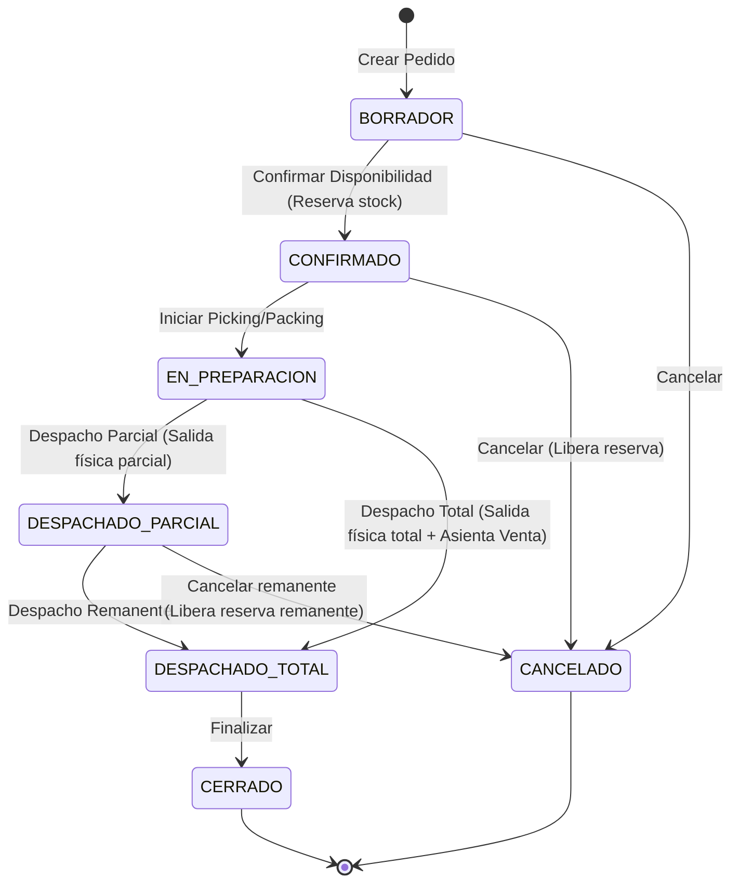
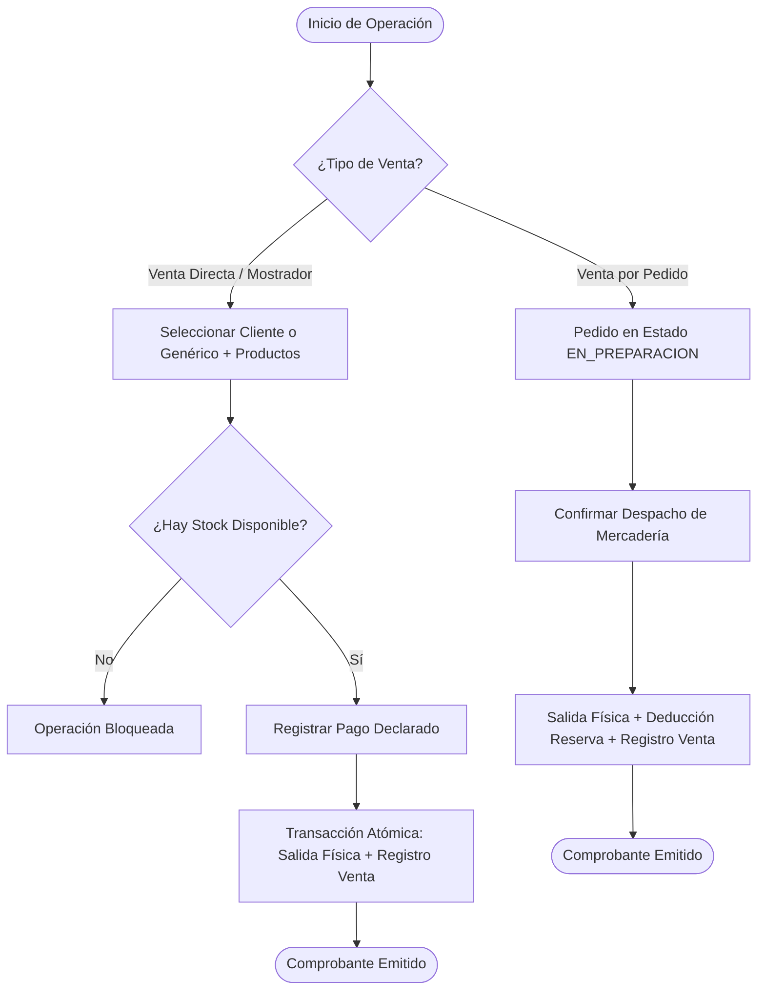
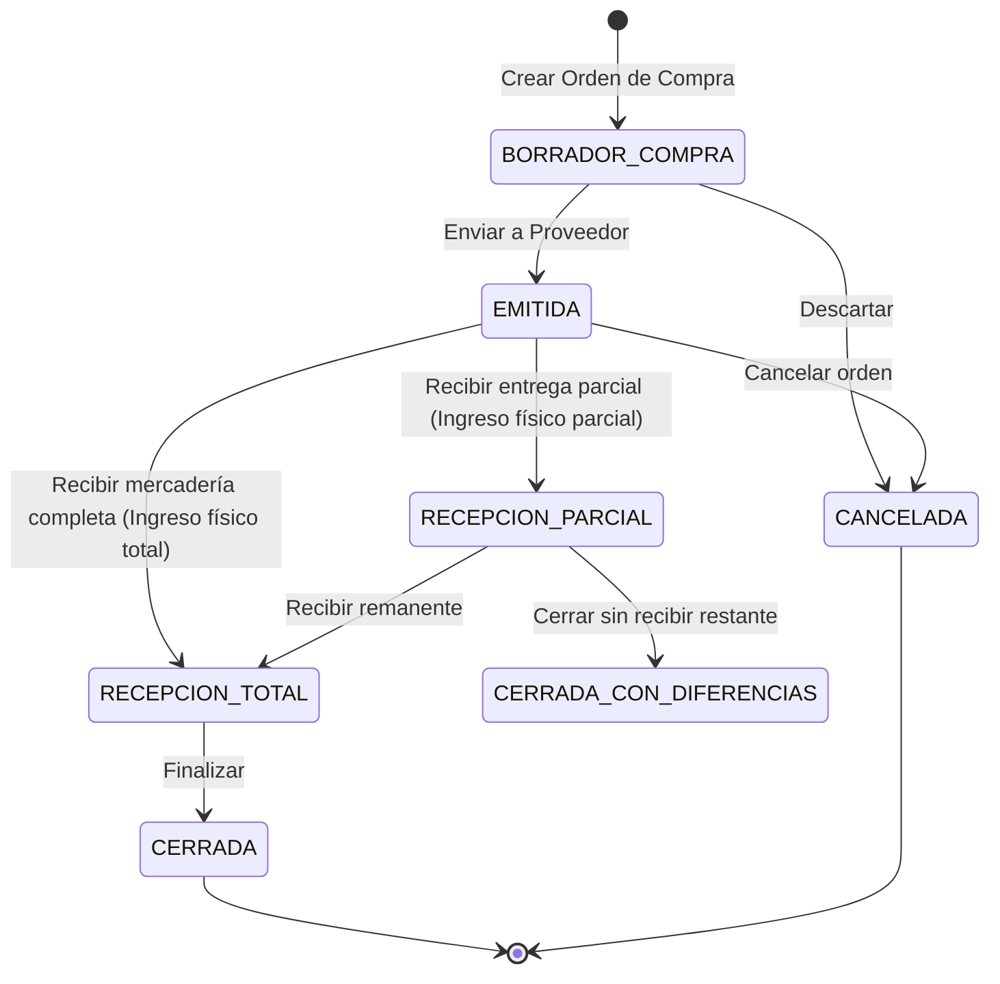

# Procesos y Máquinas de Estado
**Proyecto:** Stock-tock  
**Versión:** 1.0  

Este documento define el ciclo de vida de los datos, las transiciones de estado permitidas y las operaciones atómicas sobre el inventario.

---

## 1. Ciclo de Vida del Pedido (Order Workflow)

Un pedido permite comprometer mercadería antes de despacharla físicamente.

### Reglas de transición por estado del Pedido:
1. **`BORRADOR`:**
   - Permite editar ítems, cantidades, cliente y precios sin impactar stock.
   - **Impacto en inventario:** Ninguno.
2. **`CONFIRMADO`:**
   - Se valida que `cantidad_solicitada <= stock_disponible`.
   - Si no hay suficiente stock disponible, la confirmación se rechaza (`BLOCK`).
   - **Impacto en inventario:** Incrementa `stock_reservado`; disminuye `stock_disponible`. `stock_fisico` no se altera.
3. **`EN_PREPARACION`:**
   - La mercadería está siendo embalada. La reserva sigue activa.
4. **`DESPACHADO` (Parcial o Total):**
   - La mercadería sale físicamente del depósito.
   - **Impacto en inventario:** Disminuye `stock_fisico` y disminuye `stock_reservado`.
   - **Disparo de Venta:** En este instante se genera el comprobante y registro de venta oficial.
5. **`CANCELADO`:**
   - Si estaba confirmado o en preparación, se libera automáticamente la cantidad reservada (`stock_reservado` baja, `stock_disponible` sube).

---

## 2. Circuito de Ventas

Existen dos canales de ingreso de una venta:

---

## 3. Circuito de Compras (Órdenes de Compra a Proveedores)

### Cálculo de Costo Promedio Ponderado (PPP) al recibir compra:
Cuando ingresan $Q_{nueva}$ unidades a un costo unitario $C_{nuevo}$, el nuevo costo promedio de la empresa se actualiza mediante:

$$C_{promedio} = \frac{(Q_{anterior} \times C_{anterior}) + (Q_{nueva} \times C_{nueva})}{Q_{anterior} + Q_{nueva}}$$

---

## 4. Tipos de Movimientos de Inventario (Kardex Inmutable)

Cada movimiento de stock queda registrado de forma inalterable con: `id`, `fecha`, `producto_id`, `variante_id`, `deposito_id`, `tipo_movimiento`, `cantidad`, `stock_fisico_resultante`, `motivo`, `usuario_id` y `referencia_doc` (id de pedido, venta o compra).

| Tipo Movimiento | Efecto Stock Físico | Efecto Stock Reservado | Efecto Stock Disponible | Origen Común |
| :--- | :---: | :---: | :---: | :--- |
| `INGRESO_COMPRA` | $+Q$ | $0$ | $+Q$ | Recepción de orden de compra |
| `INGRESO_AJUSTE` | $+Q$ | $0$ | $+Q$ | Recuento físico / sobrante |
| `SALIDA_VENTA` | $-Q$ | $-Q$ o $0$ | $0$ o $-Q$ | Despacho de pedido o venta directa |
| `SALIDA_AJUSTE` | $-Q$ | $0$ | $-Q$ | Rotura, merma, pérdida |
| `RESERVA_PEDIDO` | $0$ | $+Q$ | $-Q$ | Confirmación de pedido |
| `LIBERACION_PEDIDO` | $0$ | $-Q$ | $+Q$ | Cancelación de pedido |
| `TRANSFERENCIA_SALIDA` | $-Q$ | $0$ | $-Q$ | Envío hacia otro depósito |
| `TRANSFERENCIA_ENTRADA`| $+Q$ | $0$ | $+Q$ | Recepción desde otro depósito |
| `DEVOLUCION_CLIENTE` | $+Q$ | $0$ | $+Q$ | Retorno de producto apto |
